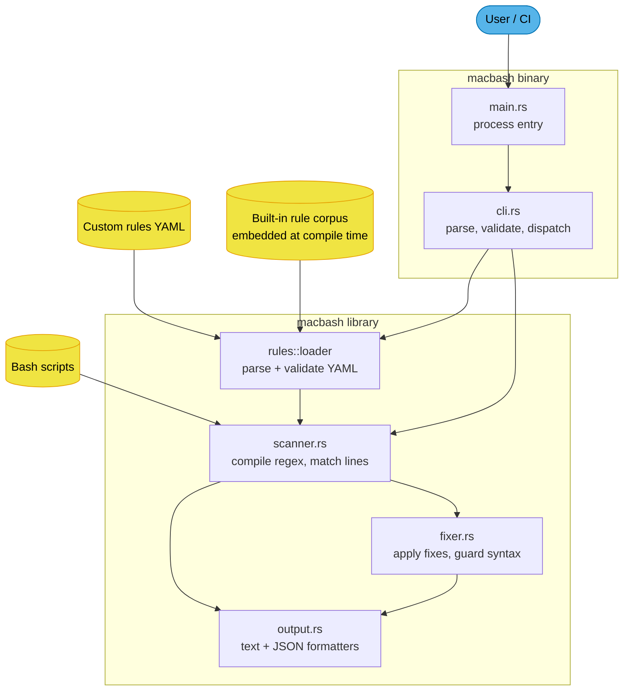
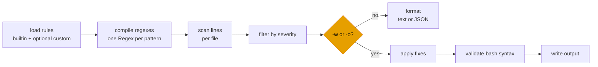

<!--
  Project:   macbash
  File:      ARCHITECTURE.md
  Purpose:   Code map -- components, data flow, and the invariants you cannot
             infer by reading a single file
  Language:  Markdown

  License:   Apache-2.0
  Copyright: (c) 2025-2026 HYPERI PTY LIMITED
-->

# Architecture

macbash is a line-based linter, not a bash parser. It compiles a corpus of
regex rules once, walks each input file line by line, and reports or rewrites
the lines that match. That single decision explains most of the design: there
is no AST, no shell grammar, and no cross-line analysis beyond a here-doc
skipper and a shebang gate.

The problem it solves: a bash script written on GNU/Linux silently misbehaves
on macOS, because macOS ships BSD userland and bash 3.2. The failures are
per-line and per-flag (`sed -i`, `grep -P`, `declare -A`), which is exactly
the shape a regex corpus handles well.

## Entry points

Start here when you are looking for something:

| You want | Read |
|---|---|
| Flags, validation, exit codes | [src/cli.rs](src/cli.rs) |
| How a line becomes a finding | [src/scanner.rs](src/scanner.rs) |
| What the tool knows about | [src/rules/builtin/](src/rules/builtin/) |
| Rule schema and loading | [src/rules/types.rs](src/rules/types.rs), [src/rules/loader.rs](src/rules/loader.rs) |
| How `-w` rewrites a script | [src/fixer.rs](src/fixer.rs) |
| Text and JSON rendering | [src/output.rs](src/output.rs) |
| The consumer-facing GitHub Action | [action.yml](action.yml) |

## Components

The binary is a thin shell over a library crate: `src/main.rs` calls
`cli::run()` and nothing else, so every behaviour is reachable from tests and
from downstream Rust consumers.

`build.rs` is outside that graph. It shells out to `git rev-parse HEAD` and
stamps a build timestamp, both exposed as env vars that `--version` prints.
It is the only build-time code in the project.

## The scan pipeline

Every invocation runs the same first three stages; only the tail differs
between check mode and fix mode.

Rule loading merges by id, later wins: a `--config` rule with the same id as a
built-in REPLACES it rather than adding a second rule. That is what makes
`--config` a genuine override mechanism and not just an append.

Regex compilation happens once per run, up front, and a bad pattern is a hard
error before any file is read. A rule pack that cannot compile never
half-scans.

## What the scanner does per line

The matcher is deliberately small, but four behaviours are load-bearing and
easy to break:

- **Here-doc bodies are skipped, but only when the here-doc is real.**
  `detect_heredoc` picks up the delimiter and the scanner suppresses every line
  until it reappears -- otherwise every embedded Linux snippet in a deploy
  script fires findings. Detection is a regex over one line, so `scan_text`
  additionally requires the delimiter to ACTUALLY appear further down before
  entering here-doc mode. That cap matters: a false positive (a `<<<`
  here-string, a `$((1 << 3))` shift) used to swallow the rest of the file, so
  macbash printed "No issues found." and exited 0 on a broken script.
- **Comment lines are skipped** unless the rule's own pattern starts with
  `^#`. That carve-out exists so shebang rules can still see line 1.
- **`shebang_match` gates a rule to a shebang.** POSIX-only rules (`[[`,
  `local`) apply to `#!/bin/sh` scripts and must not fire on `#!/bin/bash`.
- **`negative_pattern` suppresses the whole LINE for that rule.** It is a veto,
  not a per-match exclusion -- see [docs/rules.md](docs/rules.md) for the
  consequence.

Severity filtering happens AFTER scanning, not during, so `--severity error`
and `--severity info` walk exactly the same lines and differ only in what
survives.

## Fix mode is guarded, not trusted

`-w` and `-o` are marked experimental in the CLI banner for a reason: a
regex-driven rewrite can produce text that is no longer valid bash. The fixer
therefore runs `validate_bash_syntax` on the result and, if it fails, SKIPS
the write for that file and leaves the original untouched. A fix that would
corrupt a script is reported, never applied.

That guard is `bash -n` on a subprocess, and it fails OPEN: when `bash` is not
on PATH the check silently passes and the write proceeds. On a platform
without bash -- Windows, a minimal container -- `-w` has no syntax net.

Only `fix_type: replace` and a narrow `fix_type: transform` path (PCRE `grep
-P` to ERE `grep -E`) rewrite anything. `suggest` and `function` print advice
and count as unfixable, which is why a `-w` run can exit 1 with zero changes
written.

Which rules get to rewrite is a doctrine, not a convenience: **a rule only
auto-fixes when the result works on GNU and BSD alike.** Where no portable form
exists -- `date -d @EPOCH`, `xargs -r` -- the rule stays `suggest`, because
rewriting would turn a working Linux script into a macOS-only one without
saying so. `bash -n` cannot catch that class; it is a runtime difference, not a
syntax error.

## Invariants

Break these and the tests will tell you, but they are worth knowing first:

- **The rule corpus is the source of truth for behaviour.** Adding a check
  means adding YAML, not Rust. `load_builtin_returns_seventy_three_rules`
  pins the count against the upstream Go binary this project replaced; update
  it deliberately, never reflexively.
- **Every rule carries both `should_match` and `should_not_match` cases.** Two
  corpus-wide tests in `src/scanner.rs` run every example against the real
  scanner, so a rule cannot ship untested.
- **Every rewriting rule turns its `examples.bad` into its `examples.good`.**
  `every_rewriting_rule_turns_its_bad_example_into_its_good_example` in
  `src/fixer.rs` proves it against the real fixer. Matching correctly and
  rewriting correctly are separate properties, and only the first used to be
  tested.
- **The JSON output schema is the stable public contract.** Field names match
  the Go implementation one for one, pinned by
  `json_schema_field_names_match_go_oracle`. Text output is not a contract.
- **The `regex` crate has no backreferences and no lookaround.** Patterns that
  need "match X but not when followed by Y" use `negative_pattern`, not
  inline assertions. See
  [docs/decisions/0003-regex-crate-without-backreferences.md](docs/decisions/0003-regex-crate-without-backreferences.md).
- **No `unsafe`.** The crate has none and should acquire none.

## Where the rest lives

- Rule authoring, the full YAML schema, and the false-positive playbook:
  [docs/rules.md](docs/rules.md)
- Release, cross-build and packaging pipeline:
  [docs/release.md](docs/release.md)
- Recorded decisions and their trade-offs:
  [docs/decisions/](docs/decisions/)
