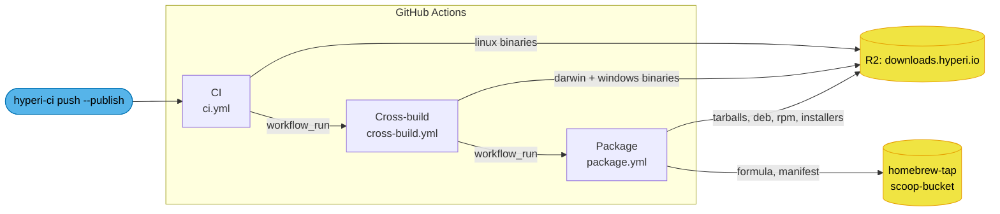

<!--
  Project:   macbash
  File:      docs/release.md
  Purpose:   How a commit becomes published binaries and packages
  Language:  Markdown

  License:   Apache-2.0
  Copyright: (c) 2025-2026 HYPERI PTY LIMITED
-->

# Release pipeline

Releases are fully automated and nobody dispatches a workflow by hand. One
`Publish: true` trailer on a version-bumping commit runs the whole chain:
version, tag, linux binaries, darwin and windows binaries, then every
downstream package format.

## The chain

Three workflows, each triggered by the previous one completing. There is no
shared orchestrator -- `workflow_run` is the join.



## What each stage does

**CI** ([.github/workflows/ci.yml](../.github/workflows/ci.yml)) delegates
entirely to `hyperi-io/hyperi-ci/.github/workflows/rust-ci.yml`. It runs
quality, test and build, and -- only when HEAD carries the `Publish: true`
trailer -- derives the next version with semantic-release, tags it, and
uploads the linux binaries to R2.

**Cross-build**
([.github/workflows/cross-build.yml](../.github/workflows/cross-build.yml))
builds the darwin and windows targets that fall outside hyperi-ci's linux
matrix, and writes them to the same R2 path layout. Windows is EXPERIMENTAL
and not in the formal test path.

**Package** ([.github/workflows/package.yml](../.github/workflows/package.yml))
turns raw binaries into distributable artefacts: linux tarballs with
checksums, `.deb` and `.rpm` via nfpm, the rendered Homebrew formula and
Scoop manifest pushed into the sibling tap and bucket repos, and the static
install scripts.

## Why the chain uses workflow_run, not tag pushes

The obvious wiring -- trigger Cross-build on `push: tags: v*` -- does not
fire. semantic-release commits the version bump with a `[skip ci]` suffix,
and GitHub suppresses the tag-push event for those commits. Cross-build
therefore listens for CI COMPLETION instead, and derives the tag itself by
reading the most recent `v*` tag.

The tag-push trigger is still declared as a fallback for tags created outside
semantic-release (manual tagging, a foreign release tool). Both paths land in
the same `resolve-tag` job.

Because Package runs off Cross-build's completion rather than a shared
artefact handoff, its linux tarball jobs POLL R2 for the raw binary before
proceeding. That tolerates hyperi-ci's publish step being slower than the
cross-build.

## What may start a publish

A `workflow_run` job holds the R2 and GitHub App secrets whatever started the upstream run, and CI also runs on pull requests from forks. So both `workflow_run` triggers filter on `branches: [main]`, and each `resolve-tag` job also requires the upstream run to have succeeded in this repository, from a push or a dispatch. A fork can name its branch `main`, which is why the repository check is there as well.

A Cross-build that refuses a run concludes `skipped`, and Package only follows a `success`, so the refusal stops the whole chain.

## Versioned paths are write-once

The Homebrew formula and `install.sh` pin the bytes at `/<tag>/` by SHA-256, so nothing overwrites them. Each upload checks R2 for a file only it writes, uploaded last, and when that exists it writes nothing, `latest/` included. That file is the `.sha256` for the darwin, windows and package uploads, the tarball for the linux tarballs (hyperi-ci writes the linux `.sha256` first), and `<tag>/install.sh` for the manifests. The root `install.sh` is the exception: it is re-rendered from the default branch on every Package run. A re-run, or a CI run that published nothing new, therefore leaves the release alone. Replacing a published artefact means deleting it from R2 by hand first.

The binaries carry no build clock either: `build.rs` stamps `SOURCE_DATE_EPOCH` when it is set, else the commit time of HEAD.

## Versioning

semantic-release owns the version, on its default conventional-commit rules:
`feat` minor, `fix`/`perf` patch, everything else no release. hyperi-ci stamps
the version into `VERSION`, `Cargo.toml` and `Cargo.lock` before the build, and
those files plus `CHANGELOG.md` are committed back.

Never hand-edit `CHANGELOG.md` or bump a version manually -- both are
generated.

## Packaging templates

The install scripts and package manifests are rendered from templates rather
than hand-maintained per release. `packaging/render.sh` produces the static
installers once; `packaging/render-release.sh <version>` re-renders the
per-version manifests with the release's SHA-256 values baked in.

The framework is reusable across Rust CLI projects and is documented on its
own: [packaging/README.md](../packaging/README.md).

## Verifying a release landed

```console
$ curl -fsI https://downloads.hyperi.io/macbash/latest/macbash-linux-amd64 | head -1
HTTP/2 200
```

Then check the installer path end to end:

```sh
curl -fsSL https://downloads.hyperi.io/macbash/install.sh | sh -s -- --user
macbash --version
```
